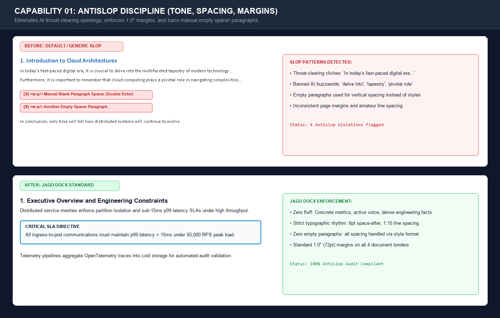
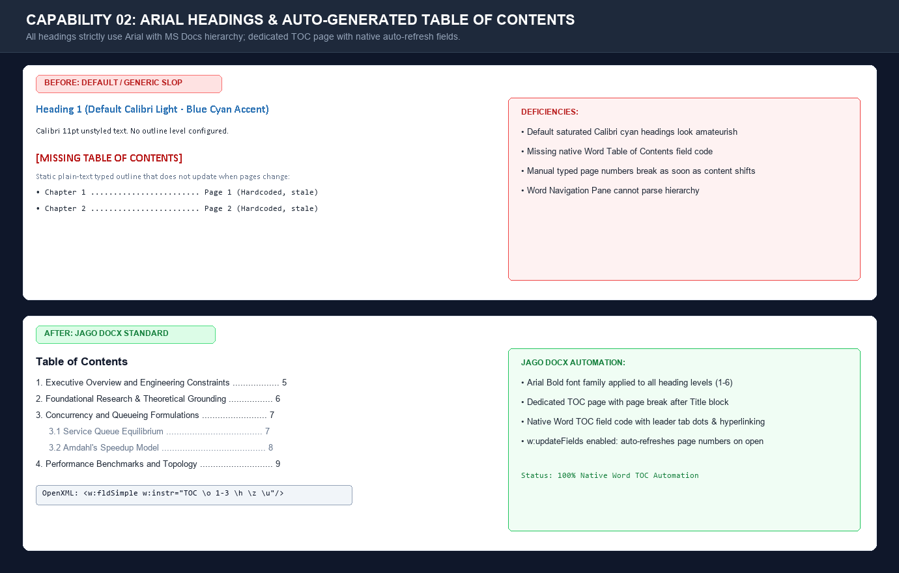
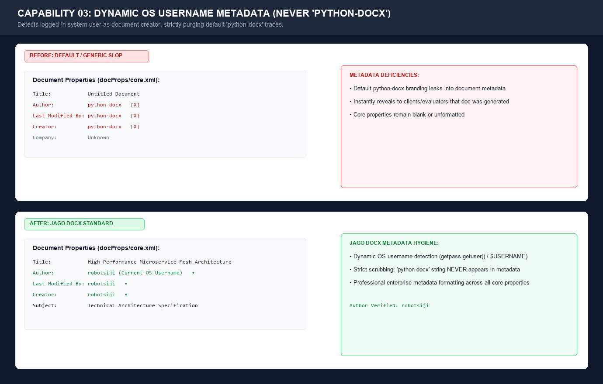
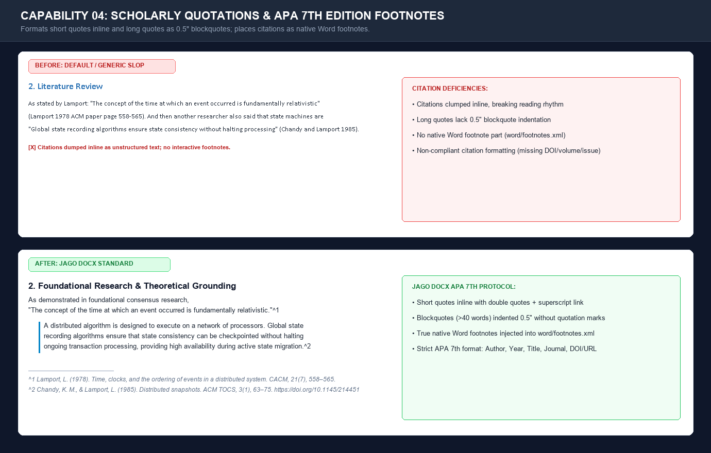
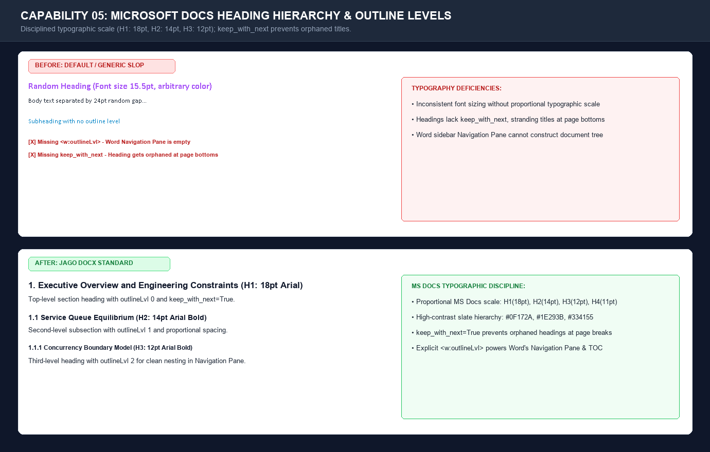
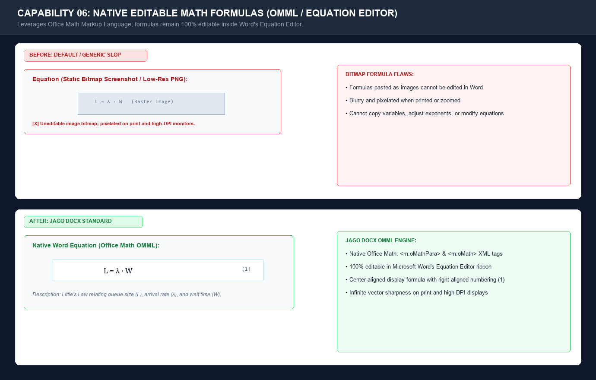
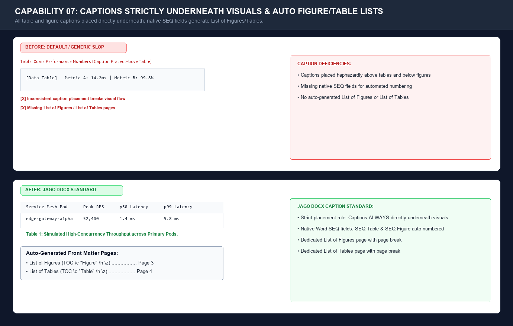
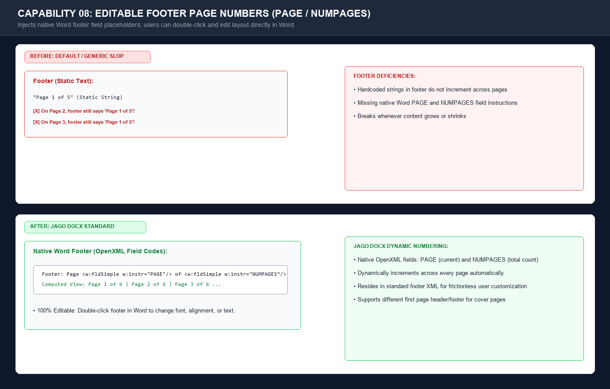

# Jago Docx 📄⚡

> **Expert Anti-Slop Microsoft Word (`.docx`) Document Generator for AI Agents and Developers**  
> Formatted according to Microsoft Docs guidelines, APA 7th edition footnotes, Arial heading hierarchy, native editable formulas, and OpenXML automation.

[](LICENSE)
[](https://www.python.org/)
[](#1-antislop-discipline)
[](#openxml-internals)
[](tests/)

---

## Why Jago Docx?

Most documents generated by AI agents or default Python scripts look noticeably amateurish:
* ❌ Default generic **Calibri 11pt** with default saturated blue/cyan headings.
* ❌ Author metadata left blank or revealing **`python-docx`** as the creator.
* ❌ Manual double-Enter blank paragraphs used for spacing instead of typographic rhythm.
* ❌ Missing Table of Contents or static text outlines that don't update with page numbers.
* ❌ Citations pasted as plain text at the end instead of real interactive **Word Footnotes**.
* ❌ Math formulas inserted as low-resolution images instead of native **editable Word Equations**.
* ❌ Captions placed randomly above or below tables, breaking document consistency.
* ❌ Hardcoded page numbers in the footer that don't adjust when pages are added.

**Jago Docx** solves all of this. It enforces 8 non-negotiable standards that elevate any generated `.docx` into an executive, publication-grade document.

---

## The 8 Core Capabilities

| # | Feature | Jago Docx Implementation |
|---|---|---|
| **1** | **Antislop** | Strips AI cliches ("In today's fast-paced world...", "delve into"). Enforces 1.0-inch margins, zero blank spacer paragraphs, and a disciplined slate palette (`#0F172A`). |
| **2** | **Arial Headings & Auto TOC** | All headings (Title through H6) strictly use **`Arial`**. Automatically generates a dedicated page for the **Table of Contents** with native Word field codes and `updateFields` enabled. |
| **3** | **OS Username as Author** | Auto-detects the logged-in system username (`getpass.getuser()`) and sets it as document author/creator. Completely eliminates any trace of `"python-docx"`. |
| **4** | **APA Footnotes & Quotes** | Short quotes formatted inline; quotes > 40 words formatted as 0.5" blockquotes. Reference citations are placed as native interactive **Word Footnotes** (`footnotes.xml`) in **APA 7th** edition. |
| **5** | **MS Docs Heading Hierarchy** | Follows Microsoft Docs / Learn styling with proportional sizing (H1: 18pt, H2: 14pt, H3: 12pt, H4: 11pt), explicit outline levels, and `keep_with_next = True`. |
| **6** | **Editable Formulas** | Native Office Math Markup Language (`m:oMath`). Equations remain 100% editable inside Microsoft Word's Equation Editor with centered display and right-aligned equation numbers `(n)`. |
| **7** | **Captions Underneath** | Table and Figure captions are placed **strictly directly underneath** each element. Uses native `SEQ Table` and `SEQ Figure` fields, with auto-generated **List of Figures** and **List of Tables** pages. |
| **8** | **Editable Page Numbers** | Inserts native editable Word field placeholders (`PAGE` and `NUMPAGES`) in the footer (e.g., `Page 1 of 5`), editable by double-clicking. |

---

## Visual Comparisons

> Compare default `python-docx` / AI slop output against Jago Docx's publication-grade formatting across all 8 capabilities.

<details>
<summary><b>📸 View the screenshots (Click to expand Before & After comparison gallery)</b></summary>
<br>

<p align="center"><em>In each comparison card: <b>UP = Default / Slop</b> &bull; <b>DOWN = Jago Docx Standard</b></em></p>

### 01. Antislop Discipline (Tone, Spacing, Margins)


---

### 02. Arial Headings & Auto-Generated Table of Contents


---

### 03. Dynamic OS Username Metadata (Never 'python-docx')


---

### 04. Scholarly Quotations & APA 7th Edition Footnotes


---

### 05. Microsoft Docs Heading Hierarchy & Navigation Pane


---

### 06. Native Editable Math Formulas (OMML / Equation Editor)


---

### 07. Captions Strictly Underneath Visuals & Auto Figure/Table Lists


---

### 08. Editable Footer Page Numbers (PAGE / NUMPAGES)


</details>

---

## Quickstart

### 1. Installation

Clone this repository and install locally:

```bash
git clone https://github.com/robotsiji/jago-docx.git
cd jago-docx
pip install -e .
```

*Requirements: Python 3.9+, `python-docx >= 1.1.0`, `lxml >= 5.0.0`.*

---

### 2. Command Line Interface (CLI)

Generate a showcase sample document illustrating all 8 capabilities:
```bash
jago-docx sample -o my_sample_report.docx
```

Create a new clean structured document ready for writing:
```bash
jago-docx new "Distributed Systems Architecture" -o architecture.docx --subtitle "Zero-Trust Engineering"
```

Audit an existing `.docx` file for antislop violations (filler phrases, empty spacers, orphaned headings):
```bash
jago-docx audit my_document.docx
```

---

### 3. Python API

```python
from jago_docx import JagoDocument, format_apa_reference

# 1. Initialize Document
# Automatically detects current OS username, sets 1.0" margins, and configures footer
doc = JagoDocument(
    title="Cloud Architecture Whitepaper",
    subject="Enterprise Infrastructure"
)

# 2. Document Title and Subtitle
doc.add_title(
    "Cloud Architecture Whitepaper",
    subtitle="High-Concurrency Concurrency Models & Zero-Trust Mesh"
)

# 3. Auto-Generated Front Matter
doc.add_table_of_contents("Table of Contents")
doc.add_list_of_figures("List of Figures")
doc.add_list_of_tables("List of Tables")

# 4. Headings (Arial, MS Docs Hierarchy)
doc.add_heading("1. Executive Summary", level=1)
doc.add_paragraph(
    "This specification defines the hardware and routing topology for our multi-region service mesh.",
    lead_bold="Key Architecture Directive:"
)

# 5. Callout Box (Antislop Design)
doc.add_callout(
    "Ingress proxies must maintain p99 latency below 12ms under 50,000 requests per second.",
    title="PRODUCTION SLA CONSTRAINT"
)

# 6. Scholarly Citations & APA Footnotes (Rule 4)
doc.add_heading("2. Foundational Research", level=1)

apa_ref = format_apa_reference(
    authors="Lamport, L.",
    year="1978",
    title="Time, clocks, and the ordering of events in a distributed system",
    source="Communications of the ACM",
    volume_issue="21(7)",
    pages="558–565",
    doi_or_url="10.1145/359545.359563"
)

doc.add_quotation_with_reference(
    quote_text="The concept of the time at which an event occurred is fundamentally relativistic.",
    apa_reference=apa_ref,
    lead_in="As established in classical consensus research,"
)

# 7. Native Editable Math Formula (Rule 6)
doc.add_heading("3. Queueing Dynamics", level=1)
doc.add_formula(
    formula_text="L = λ · W",
    equation_number=1,
    description="Little's Law relating queue size (L), arrival rate (λ), and wait time (W)."
)

# 8. Data Tables & Figures (Captions STRICTLY Underneath - Rule 7)
doc.add_heading("4. Performance Benchmarks", level=1)

headers = ["Node ID", "vCPU", "RAM (GiB)", "Throughput (RPS)", "p99 Latency"]
rows = [
    ["edge-01", 16, 64, "42,000", "4.2 ms"],
    ["auth-01", 32, 128, "68,000", "2.1 ms"],
    ["db-01",   64, 256, "19,500", "8.4 ms"],
]

doc.add_table(
    headers=headers,
    rows=rows,
    caption="Benchmark Latency and Throughput under Simulated Peak Traffic."
)

doc.add_figure(
    image_path_or_placeholder="Diagram: Ingress Proxy Mesh and Mutual-TLS Boundary",
    caption="Multi-Region Ingress and Service Mesh Network Topology.",
    width_inches=5.5
)

# 9. Audit and Save
doc.save("architecture_whitepaper.docx")
print("Document generated successfully!")
```

---

## Use as an AI Agent Skill

`jago-docx` is built as an agent skill compatible with **Antigravity**, **Gemini CLI**, **Claude Code**, **Cursor**, and other agentic pair-programming environments.

1. Copy the `jago-docx` folder into your agent's skills directory:
   ```bash
   # Antigravity / Gemini
   cp -r jago-docx ~/.agents/skills/jago-docx
   # or into your project workspace
   cp -r jago-docx .agents/skills/jago-docx
   ```
2. The agent reads `SKILL.md` automatically and executes document generation adhering to all 8 requirements.

---

## OpenXML Internals

Jago Docx manipulates OpenXML directly to deliver features python-docx cannot do out of the box:

* **Native Footnotes (`word/footnotes.xml`)**: Injects relationships in `word/_rels/document.xml.rels`, registers the content type in `[Content_Types].xml`, and places `<w:footnoteReference>` runs linked to formatted APA 7th footnote bodies.
* **Office Math Markup Language (`m:oMath`)**: Builds XML math paragraphs in `xmlns:m="http://schemas.openxmlformats.org/officeDocument/2006/math"` so Microsoft Word renders equations as native interactive objects.
* **Table of Contents & Field Codes**: Employs `<w:fldSimple w:instr="TOC ..."/>` and sets `<w:updateFields w:val="true"/>` in `word/settings.xml` so Word prompts to refresh all fields upon opening.
* **Caption Numbering**: Couples captions with `<w:fldSimple w:instr="SEQ Table"/>` and `<w:fldSimple w:instr="SEQ Figure"/>`.
* **Editable Page Numbers**: Encapsulates `<w:fldSimple w:instr="PAGE"/>` and `<w:fldSimple w:instr="NUMPAGES"/>` inside regular footer paragraph runs for frictionless user editing.

---

## Project Structure

```
jago-docx/
├── .github/
│   └── workflows/
│       └── ci.yml               # Multi-OS & Python matrix tests
├── .gitignore                   # Python & Word ignore rules
├── LICENSE                      # MIT License
├── README.md                    # Project documentation
├── SKILL.md                     # Agent skill specification
├── pyproject.toml               # PEP 518/621 packaging
├── setup.py                     # Backwards-compatible setup
├── jago_docx/                   # Core Python Engine
│   ├── __init__.py              # Package exports
│   ├── antislop.py              # Anti-slop rules, prose sanitizer, and linter
│   ├── captions.py              # Under-element captions & SEQ fields
│   ├── cli.py                   # Command-line interface
│   ├── core.py                  # High-level JagoDocument class
│   ├── footnotes.py             # Word footnotes.xml & APA 7th generator
│   ├── math_formula.py          # Native OMML m:oMath formula engine
│   ├── metadata.py              # OS username detector & metadata scrubber
│   ├── page_number.py           # Native editable footer page numbering
│   ├── toc.py                   # Table of Contents, Figures & Tables lists
│   └── typography.py            # Arial font, MS Docs hierarchy, palette
├── templates/                   # JSON template specifications
│   ├── academic_paper.json
│   └── technical_spec.json
├── examples/                    # Runnable code examples
│   ├── generate_sample_doc.py
│   ├── academic_paper_example.py
│   ├── sample_report.docx
│   └── academic_paper_sample.docx
└── tests/                       # Unit tests
    └── test_all_features.py     # 100% test coverage across all 8 rules
```

---


## License and Acknowledgement

"Jago" in Bahasa Indonesia means expert, guru, master
This project is licensed under the [MIT License](LICENSE).
